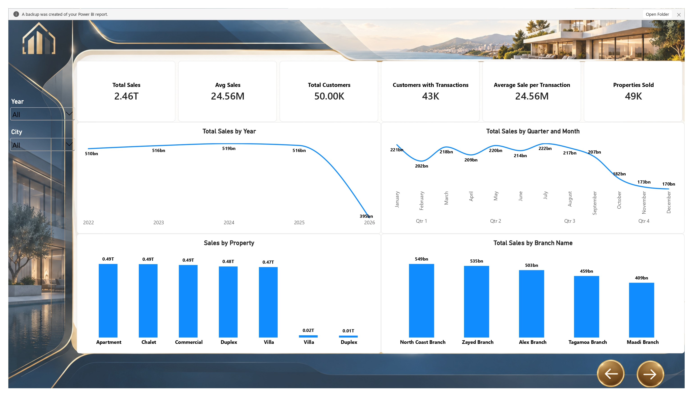
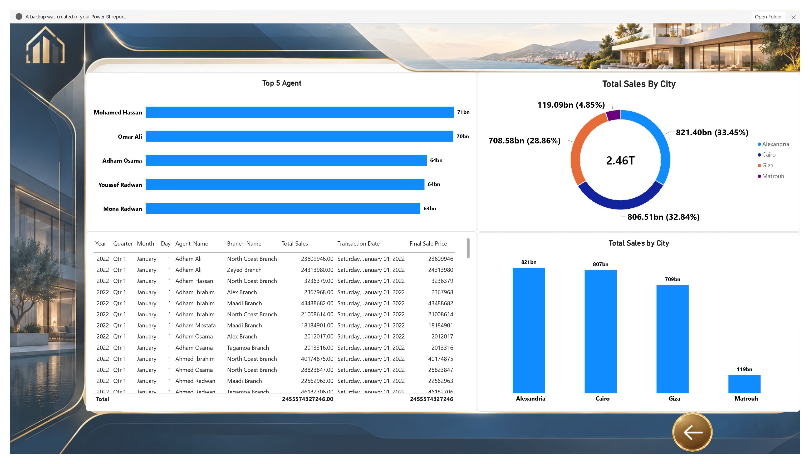

# 🏠 Real Estate Data Analytics

A Power BI project focused on exploring real estate sales performance across properties, branches, cities, and agents.

## 🎯 Project Objective

The goal of this project was to get a clearer view of real estate sales activity and compare performance across different time periods, property types, locations, and agents.

## 🔧 What I Worked On

- Reviewed real estate sales and transaction data.
- Analyzed sales performance across different years.
- Compared monthly and quarterly sales.
- Explored sales by property type.
- Compared sales across branches.
- Analyzed sales distribution by city.
- Identified the top 5 agents by sales.
- Added a detailed transaction table to support further analysis.

## 📊 Dashboard Pages

### 1. Sales Overview

This page provides a general view of real estate performance.

It includes:
- Total Sales
- Average Sales
- Total Customers
- Customers with Transactions
- Average Sale per Transaction
- Properties Sold
- Sales by Year
- Sales by Quarter and Month
- Sales by Property Type
- Sales by Branch

### 2. Agents & City Analysis

This page focuses on sales performance by agent and location.

It includes:
- Top 5 Agents by Sales
- Total Sales by City
- Sales comparison across cities
- Detailed transaction records

## 📌 Dashboard Highlights

| KPI | Result |
|---|---:|
| Total Sales | 2.46T |
| Average Sales | 24.56M |
| Total Customers | 50K |
| Customers with Transactions | 43K |
| Properties Sold | 49K |

## 🛠️ Tool Used

- Microsoft Power BI

## 🔄 Workflow

Source Data → Data Review → Sales Analysis → Power BI Dashboard → Business Insights

## 📁 Project Files

- `Real Estate.pbix` – Power BI report
- `screenshots/` – Dashboard screenshots

## 👨‍💻 Author

**Beshoy Medhat**

Data Analyst
